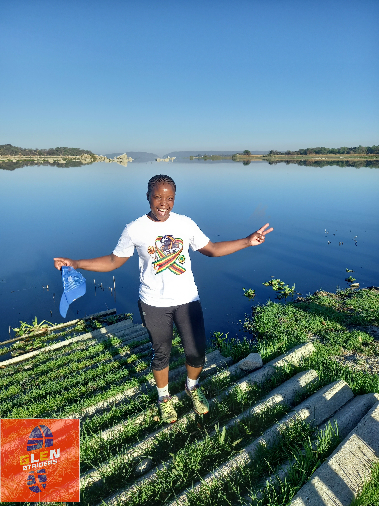

Glen Striders family, we have a winner!

This month’s Athlete of the Month is Linda Mhako, and she did it in the days leading up to her 43rd birthday. Happy birthday for tomorrow, Linda! 🎂

Here’s what Linda put on the board in October:

- Points: **41 points**
- Distance: **292.4 km**
- Elevation: **1,703 m** of elevation

Early mornings, weekly leaderboard finishes and a lot of hills.

### Meet Linda

You know her as our club social secretary, the person who keeps us connected and makes the Striders feel like a family and not just a club.

Linda runs for her health and fitness, and she hasn’t raced yet. She’s now thinking about lining up for the podium in the Veterans category (ages 40 to 49). If she does, we’ll all be on the sidelines making noise!

She is also only the second woman after Yvonne to be named Athlete of the Month in Glen Striders history. We hope she is the first of many to come!

### Best Male: Tawanda Togara 👏🏾

Tawanda, who was also our Athlete of the Month in July, takes Best Male with 31 points, 222.1 km and 1,533 m of climbing. Well done, Tawanda!

### How the points work 📊
The Athlete of the Month Award rewards showing up, week after week. Here’s how you score:

- 🏃 Weekly leaderboard position: 10 points for 1st, 9 for 2nd, 8 for 3rd, all the way down to 1 point for 10th
- ⏱️ Club time trial: +2 points (held on the last Thursday of the month)
- 🎽 Attending a race: +3 points
- 🏅 Official race category position: 1st = 5 points, down to 1 point for 5th
- ⛰️ Monthly elevation: +1 point at 250 m, rising to +5 points at 1,250 m

If there’s a tie, we look at total km for the month, then races run, then podium finishes, then highest elevation.

Look at Linda’s month. She earned 36 points from the weekly leaderboard and 5 elevation points for passing 1,250 m of climbing. She hasn’t even raced yet, so she wasn’t earning any race points. She won through consistency.

### What the award is for
The Athlete of the Month isn’t only for the fastest runners. It celebrates consistency, effort and commitment, and it encourages all of us to move a bit more and push a bit further. In October, 44 athletes logged kilometres with us, and every one of them helped build this club.

### To our members
Next month’s leaderboard starts now. Join the weekly runs, come to the time trial on the last Thursday, and keep climbing those hills. Your name could be next. 👀

### To anyone who isn’t running yet
Linda started running for her health, and now she’s our Athlete of the Month. You don’t need a race, a fast time or years of experience to start, just a first run. Come and join us, say hello, and see what we’re about.

Congratulations, Linda! Here’s to many more kilometres, and maybe a podium.

Glen Striders: running against all odds.
