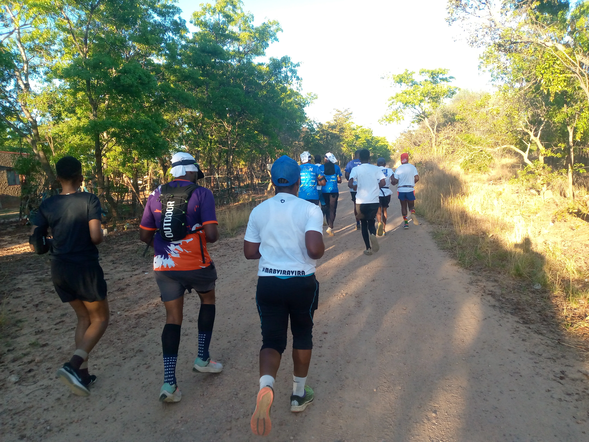
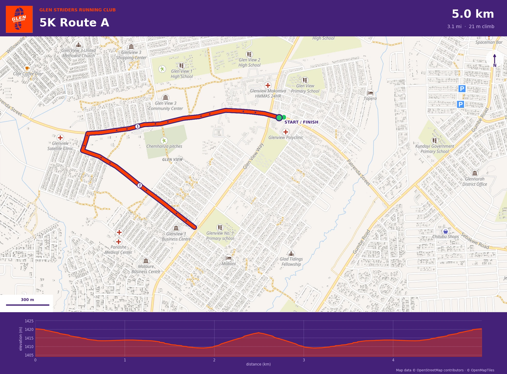
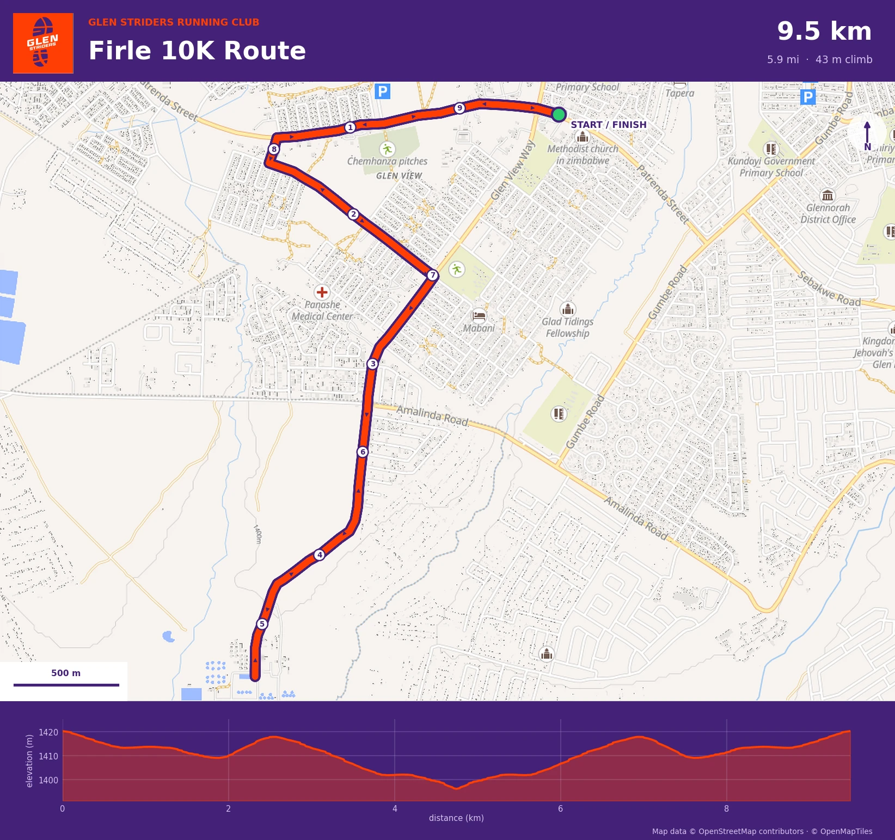
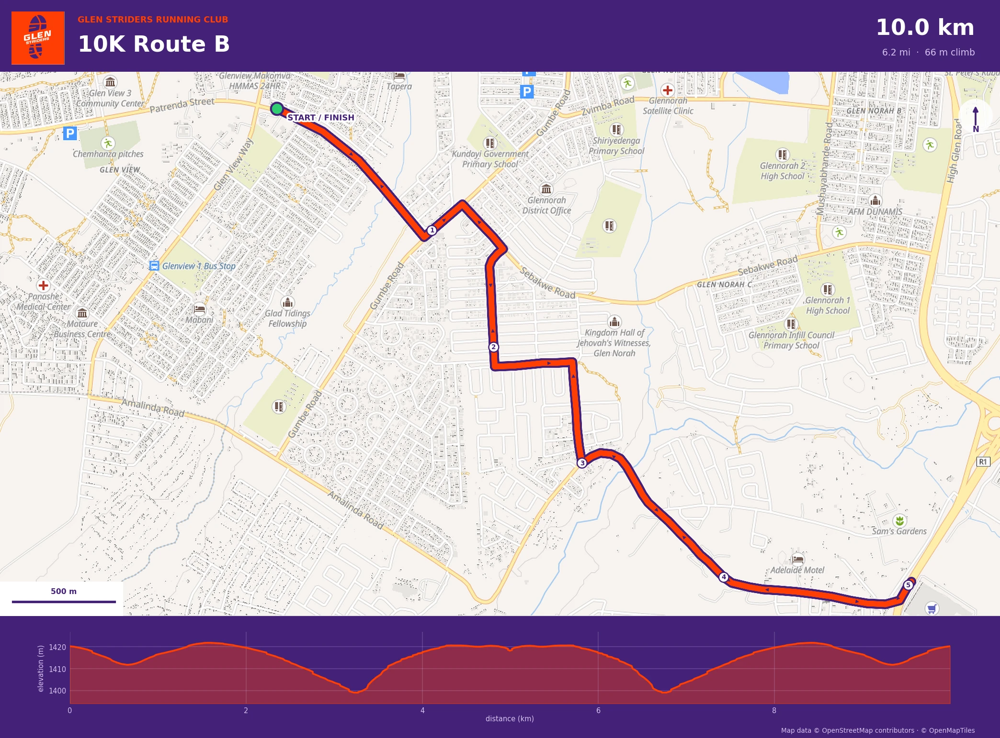
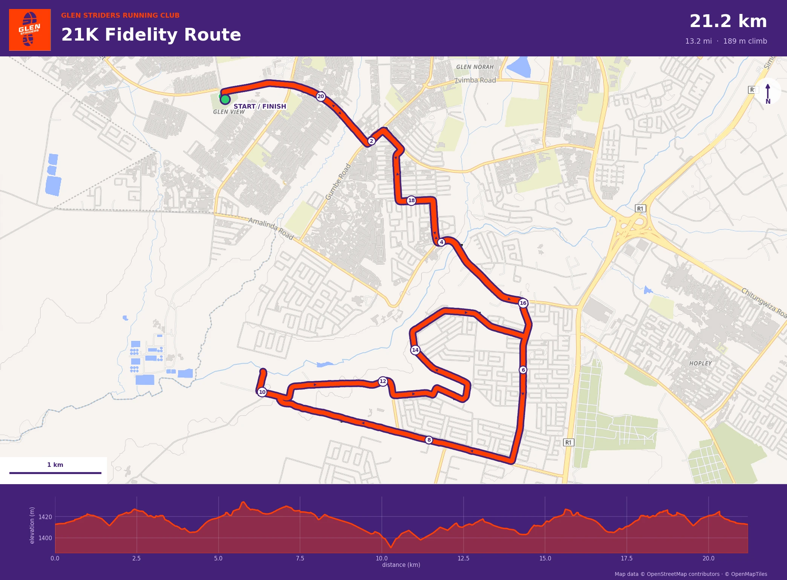
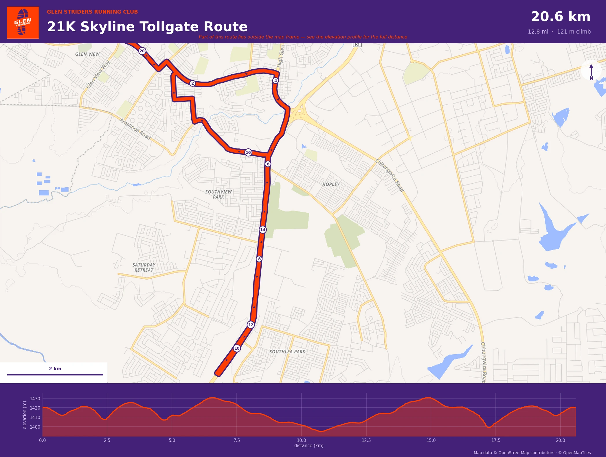
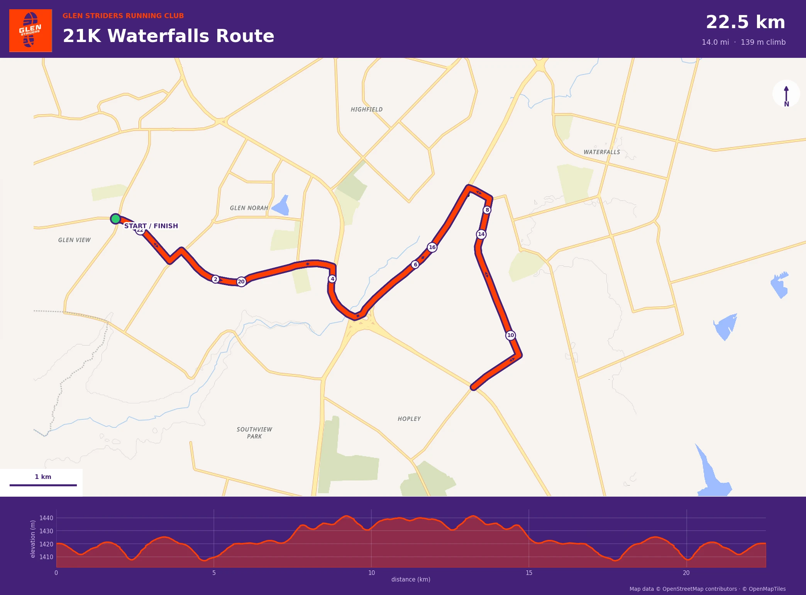
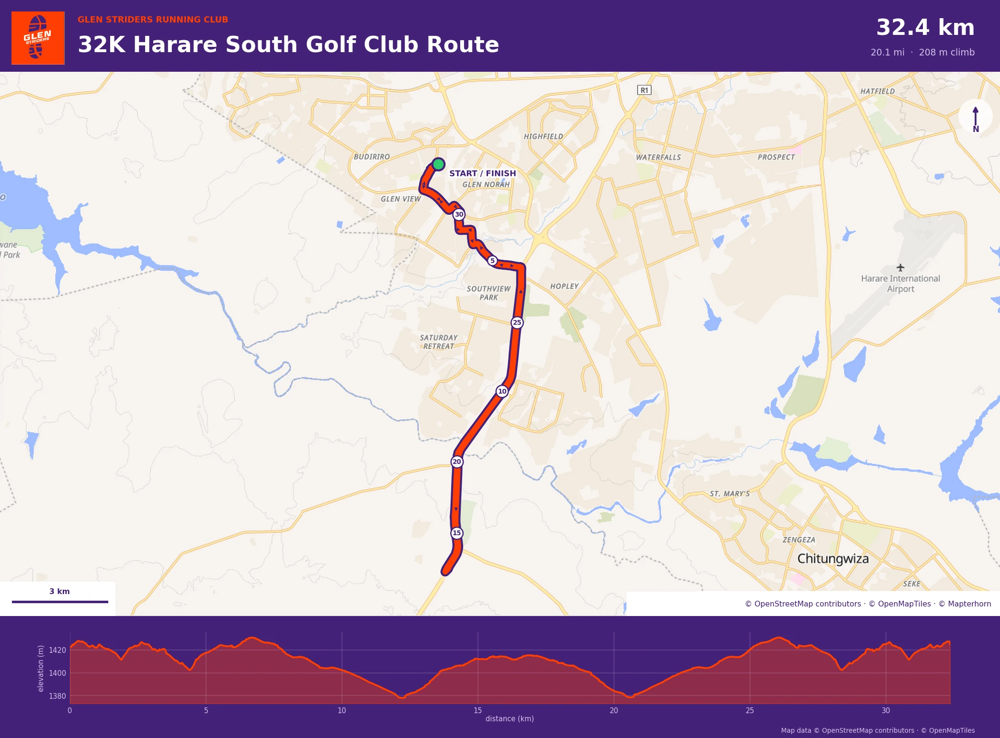
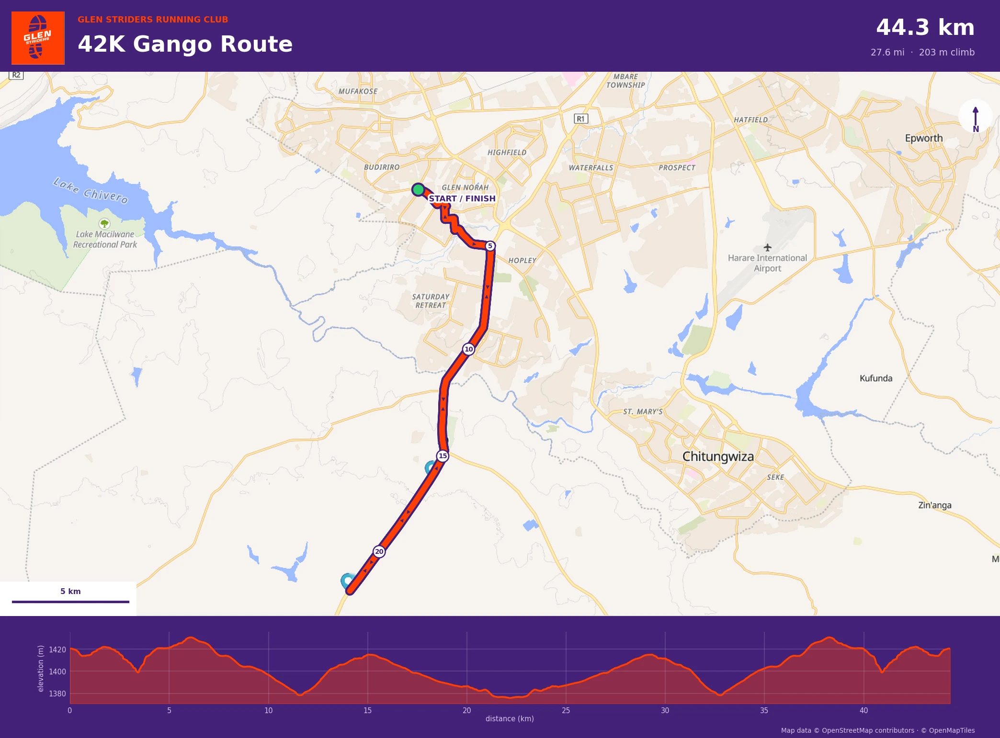
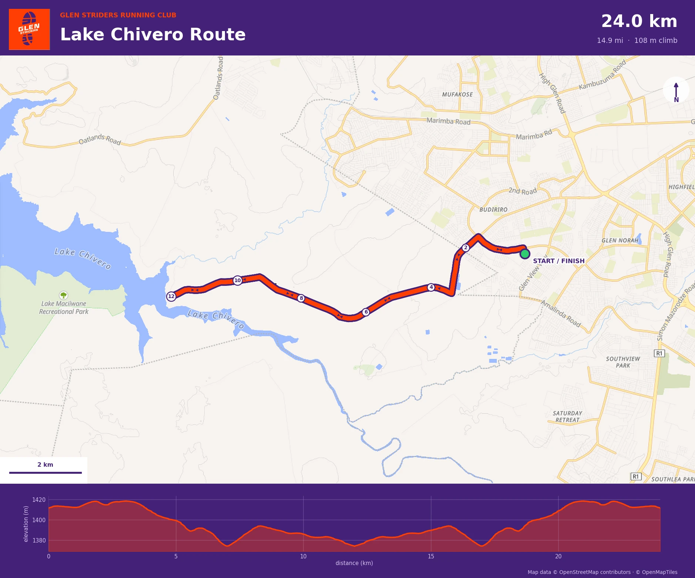

*By Glen Striders Running Club*

Ask any runner what makes a good route and you'll hear the same things: it should be easy to get to, kind to your knees, and give you a reason to come back next week. At Glen Striders we think we've got all three. From Glen View we run everything from a quick 5K to a marathon-distance long run, and we've finally put our favourite routes on the map, literally. Here's the tour.

## One starting point, nine ways to run

Almost every route we run begins in Glen View. That's the beauty of it: whether you're lacing up for your first 5K or your twentieth long run, you show up at the same place, and the only thing that changes is how far you decide to go.

The terrain is friendly too. Our GPS tracks put these routes at around 1,400 metres above sea level, and they roll gently rather than climb. The 5K gains barely 20 metres in total. Fast times and happy knees live here.

## Start here: the 5K and the Firle 10K

**5K Route A (5.0 km).** Our simplest route, and the one we point every newcomer to. It heads west out of Glen View along Patrenda Street, drops down towards Glen View Way and turns around. Short, flat and impossible to get lost on.

**Firle 10K (9.5 km).** Same friendly opening, then it keeps going down Glen View Way and across Amalinda Road before turning for home. It's a good first step up once the 5K feels comfortable.

## Step up: 10K Route B

**10K Route B (10.0 km)** takes you through Glen Norah, along Gumbe Road and Sebakwe Road, then south-east towards the R1 before you turn back at the halfway mark. Because it's an out-and-back, you get to cheer on the rest of the group as they come the other way.

## The half-marathon trio

Training for a half? We've got three ways to get your 21 kilometres in, and each has its own character.

- **21K Fidelity (21.2 km):** out through Glen Norah and then winding through the suburbs to the south, finishing with a loop at the far end. Plenty of turns to keep your mind busy.
- **21K Skyline Tollgate (20.6 km):** the straightforward one. A long run south past Southview Park, turning around at about the 10 km mark. Perfect for settling into a steady pace.
- **21K Waterfalls (22.5 km by our GPS):** our only full loop of the three, taking in Glen Norah, Hopley and the edge of Waterfalls before bringing you back to the start. A little over a half marathon, so it doubles as a good stretch-goal run.

## Long-run country

When the weekend long run calls, we head south.

**32K Harare South Golf Club (32.4 km)** and **42K Gango (44.3 km)** both follow the long road south past Southview Park and Saturday Retreat before turning around. The Gango route runs a touch over marathon distance by our GPS, which makes it a handy dress rehearsal if you're building towards a full marathon. Carry water and fuel, because once you're out there, the road is long and quiet.

## For the view: the Lake Chivero route

**Lake Chivero Route (24.0 km)** is the one for scenery. It heads west out of Glen View, past Budiriro and out across open country until you reach the shore of Lake Chivero, then turns around and brings you home. If you want a long run that feels like an adventure, this is it.

## A few tips before you go

- **Out-and-back routes mean you'll pass your friends.** Wave, shout, repeat.
- **Plan water for anything over 10K.** Stash a bottle at a turnaround point or run with a hydration belt.
- **Mind the traffic.** Face oncoming cars where there's no pavement, and wear something bright for early starts.
- **Check the elevation profile on each map** so you know what to expect before you start.

## Run with us

The best route is the one you run with good people. Whichever distance you choose, there's a place for you in the Glen Striders pack.

**Follow us on Facebook:** [facebook.com/glenstriders](https://facebook.com/glenstriders)

**Enjoyed this? Share it with a running buddy:** [Share on Facebook](https://www.facebook.com/sharer/sharer.php?u=https://glenstriders.co.zw/we-have-one-of-the-best-running-routes-in-town)

*Map data © OpenStreetMap contributors © OpenMapTiles.*
